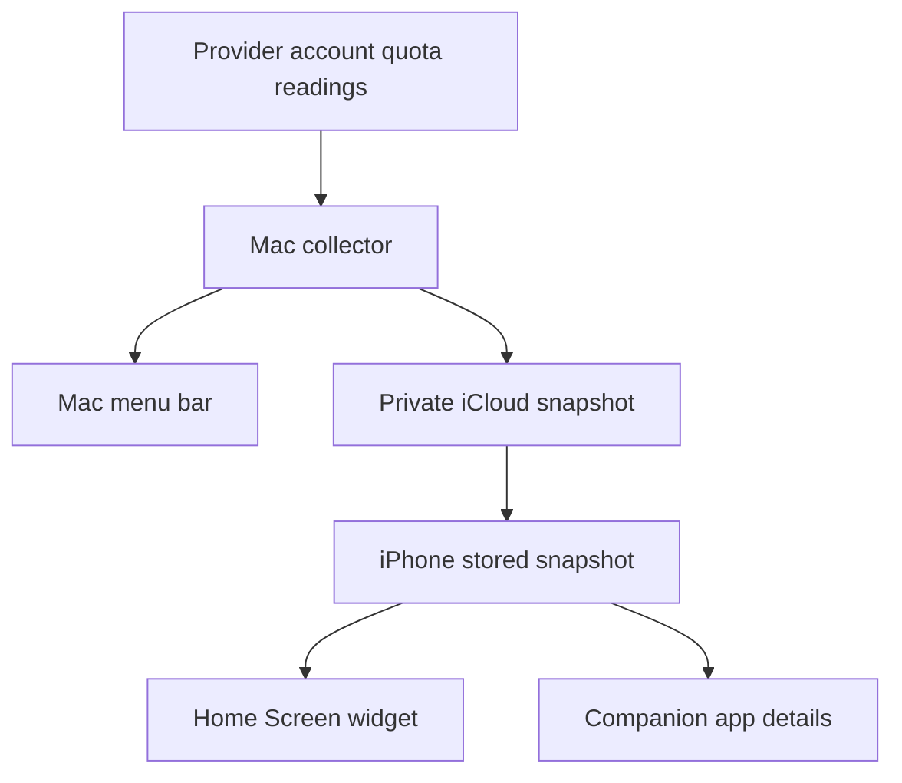
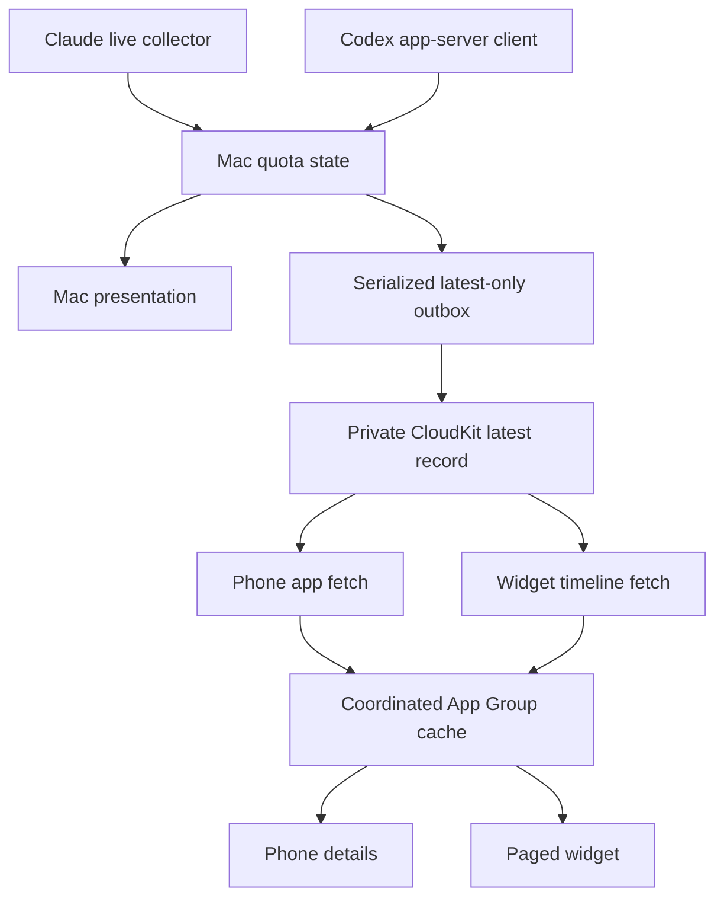
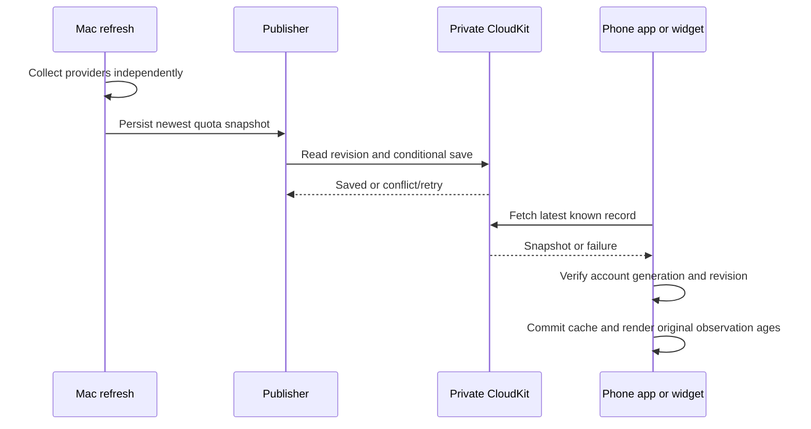
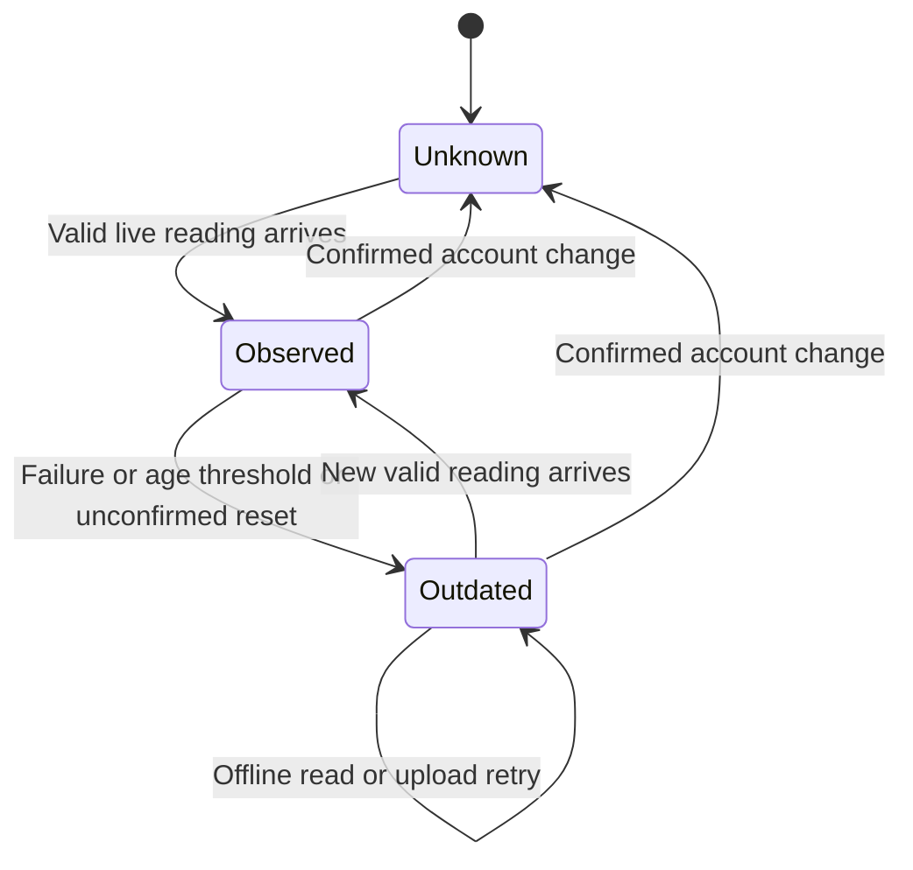

# iPhone Usage Widget - Plan

## Goal Capsule

- **Objective:** Scott can compare available Claude and Codex capacity from his iPhone Home Screen and decide which model to use while away from his Mac.
- **Means:** A native iPhone widget and small companion app receive private iCloud snapshots collected by the existing Mac app (KTD1-KTD3).
- **Product authority:** This Product Contract records the scope Scott confirmed on October 14, 2026. OpenClaw integration is deferred.
- **Execution:** Implement and verify U1-U7 in dependency order. Scott supplies Apple account/device access and completes any interactive signing or device trust steps.
- **Authority:** Product behavior follows R1-R12; technical mechanisms follow KTD1-KTD10. Implementation units refine those decisions without expanding scope.
- **Stop conditions:** U1 must establish signing, private transfer, and current Codex account access before dependent feature work. If a gate fails, report the evidence and required prerequisite; do not replace the approved delivery approach or treat local logs as current account readings.

---

## Product Contract

### Summary

Add a native iPhone Home Screen widget that displays Claude/Codex usage bars, reported model-specific caps, reset times, and reading age.
A small companion app provides setup and detailed readings, using private snapshots published by the Mac.

### Problem Frame

Scott starts remote sessions on this Mac through the Claude and ChatGPT mobile apps and sometimes starts cloud sessions.
The menu bar app is unavailable at the moment he needs to choose a model from his phone.
The Mac normally stays awake and online while he is away.

### Key Decisions

- **Native iPhone companion and widget.** Direct Home Screen visibility is the intended experience. Governs R1, R2, R4. (session-settled: user-approved — chosen over a phone webpage or Scriptable widget: a dedicated native widget fits the confirmed experience.)
- **Private iCloud snapshots from one Mac.** Avoid requiring an active phone-to-Mac VPN connection. Governs R6, R7, R8. (session-settled: user-approved — chosen over direct Tailscale access: the phone can receive the latest published readings through iCloud.)
- **Current account capacity.** Local transcript snapshots alone cannot reliably reflect cloud activity. Governs R5, R9. (session-settled: user-approved — chosen over simply mirroring the existing Codex log snapshot: the phone must support decisions after cloud activity too.)
- **Capacity-focused first version.** Governs R2 and the Scope Boundaries below. (session-settled: user-approved — chosen over a full mobile usage dashboard: spending charts, notifications, and automatic recommendations are deferred.)
- **Defer the separate OpenClaw box.** No separate collector or Slack integration belongs to this work. (session-settled: user-directed — chosen over expanding the widget to explicitly integrate OpenClaw: start with the originally proposed phone widget.)

### Requirements

**Phone experience**

- R1. Scott can install a personal iPhone companion app and add its native widget to the Home Screen.
- R2. The widget shows Claude and Codex usage bars for reported five-hour and weekly windows, plus reported model-specific caps; it never invents a separate allowance for a model that shares an account limit.
- R3. Each displayed window identifies its provider or model, labels its percentage as used, and shows the available reset time in the phone's local time.
- R4. Opening the companion app provides setup guidance, complete limit details, and a refresh action that retrieves the latest published snapshot; this action does not force the Mac to make a new provider request.

**Collection and private delivery**

- R5. The Mac obtains current account-limit readings for the signed-in Claude and Codex accounts, including local and cloud consumption covered by those account allowances.
- R6. The Mac publishes limit snapshots after collection using the existing launch, manual-refresh, and approximately 15-minute background cadence.
- R7. Snapshots reach the iPhone through private iCloud storage for the same signed-in iCloud user and contain only usage-limit values and display metadata; provider credentials and session contents remain on the Mac.
- R8. The phone retains the last successfully received readings when the Mac, iCloud, or phone connection is unavailable.

**Freshness and failure behavior**

- R9. Each provider's reading retains its actual observation time and exposes its age; re-reading, uploading, or downloading a cached value must not make it appear freshly observed.
- R10. A missing or expired unconfirmed reading is visibly unknown or outdated rather than presented as verified zero usage, and one provider's failure does not hide the other's valid readings.
- R11. Background widget updates follow iOS scheduling without promising a fixed delivery interval, while the companion app can retrieve the latest published snapshot on demand.

**Compatibility**

- R12. Adding collection and sync preserves the Mac app's ability to read local usage, access its existing provider credentials, and operate its menu bar display.

The widget's content follows the existing provider-row vocabulary: provider or model name, applicable usage windows, percentages, and reset information.
Reading age accompanies the values it qualifies, per R9.
The companion app presents the complete detail covered by R4; visual styling and the supported Home Screen size are implementation-planning choices that must preserve R2 coverage.

This diagram illustrates R5-R8; the Mac remains the collector and the phone consumes published readings.

### Key Flows

- F1. **Set up phone access.** Scott installs the companion app, connects the shared iCloud context, receives the first published snapshot, and adds the widget. Setup distinguishes waiting for the first reading from unavailable iCloud access. **Covers R1, R4, R7, R10.**
- F2. **Choose a model while away.** Scott checks the widget's bars, reset times, and reading ages before starting work in the mobile apps. Opening the companion app retrieves the newest published snapshot and exposes all reported details. **Covers R2-R4, R9, R11.**
- F3. **Publish updated capacity.** A Mac refresh obtains provider readings and publishes the snapshot; a later phone refresh receives it and updates the displayed values. Failed sources retain their previous observation times. **Covers R5-R7, R9-R11.**
- F4. **Continue through an interruption.** A failed collection or sync leaves last-known data available with its age, while unavailable or expired unconfirmed windows stay distinguishable from confirmed zero usage. Recovery replaces readings when newer data arrives. **Covers R8-R11.**

### Acceptance Examples

| Example | Situation | Expected result |
| --- | --- | --- |
| AE1. First setup | No snapshot has been published yet. | Setup explains that readings are pending; neither the app nor widget shows fabricated 0% bars. Covers R1, R4, R10. |
| AE2. Normal comparison | Both providers report windows and Claude reports an additional model cap. | The widget shows the applicable bars with used percentages, reset times, and reading ages; all details are available in the app. Covers R2-R4, R9. |
| AE3. Cloud consumption | Cloud work changes a covered account allowance without another local model turn. | A subsequent successful account-limit read and delivery reflect the change on the phone. Covers R5-R7. |
| AE4. One provider fails | Claude collection succeeds while Codex collection fails. | Claude advances to its new reading; Codex retains its previous observation time or remains unknown if it has never succeeded. Covers R9, R10. |
| AE5. Mac or network unavailable | The phone has an earlier snapshot but cannot obtain a newer one. | Last-known values remain available with their age and outdated state, rather than being relabeled fresh. Covers R8-R11. |
| AE6. Reset passes while stale | A stored window's reset time passes with no confirming provider read. | The phone distinguishes the expired, unconfirmed window from a freshly observed 0% window. Covers R10. |
| AE7. Refresh from the phone | The Mac's last published snapshot is ten minutes old. | Refresh retrieves that snapshot and preserves its ten-minute age; it does not imply a new provider observation. Covers R4, R9, R11. |
| AE8. Desktop compatibility | Snapshot publication is enabled in the signed Mac app. | Local usage collection, credential access, and the menu bar continue to operate. Covers R12. |

### Scope Boundaries

- This version covers one Mac collector, one iPhone, and the currently signed-in Claude/Codex accounts.
- Separate OpenClaw collection, additional machine/account aggregation, and Slack integration are deferred. Incidental consumption already included in a provider's account total is not subtracted.
- Spending charts, cost attribution, historical analytics, notifications, and automatic model recommendations are deferred.
- Lock Screen widgets, Apple Watch support, and public App Store distribution are deferred.
- Ordinary ChatGPT model quotas outside the documented Codex account-limit surface are not promised.
- Fresh provider collection while the Mac is offline is outside this version; R8 governs the phone's retained snapshot.

### Dependencies and Assumptions

- Scott believes he has an active Apple Developer membership; this has not been verified.
- Both devices are assumed to use the same iCloud account with the required iCloud access enabled.
- The Mac normally remains awake and online, as Scott confirmed.
- The existing Mac target is ad-hoc signed and unsandboxed. Private iCloud publication needs signing and entitlement validation without breaking R12; documentation alone has not established that this integration works in the current target.
- Codex documents a current account-limit read independent of a model turn. Its authentication compatibility, reported buckets, and update latency have not yet been tested against Scott's account.
- Provider-reported allowances define coverage; the widget does not calculate subscription capacity from token counts or estimated dollar costs.

### Outstanding Questions

**Resolve Before Planning:** None.

**Planning disposition:** Signing, real-device private transfer, and current Codex account/workspace access are execution gates in U1. KTD1 and KTD8 select the installation baseline and widget family, subject to verifying the actual device. KTD2-KTD7 and KTD9 resolve transport, caching, refresh, and failure handling. These checks preserve the approved scope; failure requires reporting the conflict before substituting another delivery approach.

### Sources and Research

- `CCUsageBar/CCUsageBar/AppState.swift:70` and `CCUsageBar/CCUsageBar/CCUsageRunner.swift:29`: existing launch/refresh/cache flow and local ccusage execution.
- `CCUsageBar/CCUsageBar/LimitsView.swift:20` and `CCUsageBar/CCUsageBar/ClaudeLimitsFetcher.swift:67`: current provider rows and dynamically reported scoped model caps.
- `CCUsageBar/CCUsageBar/CodexLimitsReader.swift:69`, `CCUsageBar/CCUsageBar/LimitsData.swift:7`, and `decisions.md:6`: observation-time, expiry, and other-machine freshness limitations that R5 and R9-R10 address.
- `CCUsageBar/CCUsageBar/ClaudeLimitsFetcher.swift:108` and `CCUsageBar/CCUsageBar.xcodeproj/project.pbxproj:198`: existing credential access and signing constraints relevant to R7 and R12.
- [Apple: creating a widget extension](https://developer.apple.com/documentation/widgetkit/creating-a-widget-extension) and [keeping a widget up to date](https://developer.apple.com/documentation/widgetkit/keeping-a-widget-up-to-date): native widget packaging and refresh constraints.
- [Apple: configuring iCloud services](https://developer.apple.com/documentation/xcode/configuring-icloud-services), [CloudKit containers](https://developer.apple.com/documentation/cloudkit/ckcontainer), and [Developer ID certificates](https://developer.apple.com/help/account/certificates/create-developer-id-certificates/): private shared storage and Mac signing feasibility.
- [Codex app-server account limits](https://learn.chatgpt.com/docs/app-server#6-rate-limits-chatgpt) and [Codex usage scope](https://developers.openai.com/codex/pricing#what-are-the-usage-limits-for-my-plan): documented account quota retrieval and local/cloud allowance scope.

---

## Planning Contract

**Product Contract preservation:** Product Contract unchanged in meaning; R1-R12, F1-F4, and AE1-AE8 retain their IDs. Outstanding questions now point to their technical decisions and execution gates.

### Key Technical Decisions

- KTD1. **Three application targets in the existing Xcode project.** Keep the macOS 14+ menu bar target unsandboxed; add an iOS 17+ SwiftUI companion and embedded WidgetKit extension. Use Apple Development signing and Xcode installation on Scott's phone for the first release, with the same developer team and CloudKit Development environment on every target. Verify active membership and actual phone OS in U1. A later distribution route requires an explicit matched environment change across both devices. This instantiates R1 and R12. (session-settled: user-approved — native targets chosen over a webpage or Scriptable widget: direct Home Screen access is the confirmed experience.)
- KTD2. **One latest record in one private CloudKit container.** Explicitly select the same container identifier for Mac, phone, and widget; fetch the known record ID rather than build queries, subscriptions, or history sync. The record contains a versioned encoded quota snapshot and ordering metadata. Its incarnation is identified by an opaque UUID and CloudKit server creation date; readers compare incarnation creation date before revision, so record recreation can recover from a lower counter without accepting a delayed former incarnation. Only the Mac writes. This implements R6-R8; Apple's [container configuration](https://developer.apple.com/documentation/xcode/configuring-icloud-services) and [private database](https://developer.apple.com/documentation/cloudkit/ckcontainer/privateclouddatabase) define access. (session-settled: user-approved — private iCloud delivery chosen over direct VPN access: the phone reads the latest published snapshot.)
- KTD3. **A small shared snapshot model compiled into all consumers.** Share Foundation models, presentation policy, and CloudKit access through explicit target membership, without a new package dependency. The schema carries a version, snapshot revision, and independent provider observations. Each provider slot has an opaque account-context generation and monotonically ordered accepted-attempt sequence. Its observation has source and observation time, plus a separate last-attempt timestamp/outcome, and a list of stable bucket/window IDs with supplied labels, durations, used percentages, and optional resets. Missing values remain optional; raw provider responses, credentials, email addresses, and session contents never enter this type. Decode unknown fields tolerantly, reject unsupported schema versions without destroying a valid cache, and replace a provider's complete window list on successful collection. Governs implementation of R2-R3 and R7-R10.
- KTD4. **Separate observation, attempt, and transfer time.** A successful live response establishes observation time; cache reads and uploads preserve it. Always display each provider's observation age. Mark a reading outdated at 60 minutes, immediately after a known failed collection, or when its window reset passes without confirmation. Keep its last-known number as dated history with a neutral appearance; missing values use an unknown state. Invalid/future observation times are unverified. Use a clock-injected policy shared by Mac, app, and widget. This replaces the old expiry-to-zero rule in `LimitsData.swift` under R9-R10.
- KTD5. **Use a bounded local Codex app-server client for current quotas.** Reuse the installed CLI's current ChatGPT login and intended workspace. Complete initialization, read account identity and `account/rateLimits/read`, then shut down the subprocess; never start a model turn. Prefer `rateLimitsByLimitId`, falling back to the legacy singleton only when the map is absent. Decode windows by their reported duration and scope, not primary/secondary position, and do not invent model mappings. Use asynchronous pipe draining, request-ID correlation, cancellation, and a 15-second whole-operation timeout. Unsupported login/version or missing quotas yields unavailable data. The old local-log reader is retired as a primary source; no fallback is needed for v1. This implements R5 and R9 using the [documented protocol](https://learn.chatgpt.com/docs/app-server#6-rate-limits-chatgpt). (session-settled: user-approved — current account readings chosen over mirroring historical local logs: cloud activity must be represented.)
- KTD6. **Serialize publication and persist only the newest pending snapshot.** Refresh collection remains independent from CloudKit availability and from ccusage costs. AppState permits one active collection per provider and rejects superseded account-generation results before assigning an accepted-attempt sequence. A single publisher coalesces pending work, persists its latest unsent payload, and retries on later refreshes while honoring CloudKit retry-after guidance. Reconcile with the server before allocating a monotonically increasing revision, including after reinstall. Within the same provider generation, compare accepted-attempt sequences and retain the later state; an explicit invalidation supersedes retained observations. On lost local generation state, discard the old outbox and establish current provider context through live reads before publishing. Use conditional saves; a conflict triggers rereading and comparison, never blindly replaying an old payload with a larger revision. Publication failures do not alter observation times. See Apple's [save policies](https://developer.apple.com/documentation/cloudkit/ckmodifyrecordsoperation/savepolicy) and [conflict handling](https://developer.apple.com/documentation/cloudkit/ckerror/serverrecordchanged). Governs R6 and R8-R12.
- KTD7. **Both phone processes may fetch; their cache has one transaction boundary.** The app and extension share an App Group state file containing account binding/generation, snapshot, and page state. Coordinate read-compare-replace across processes: capture the shared generation before fetch, then reread it inside the commit transaction and accept only matching-generation responses ordered by KTD2 incarnation and revision. Invalidation atomically advances the shared generation and clears data while retaining the generation barrier. Paging modifies only page state, never a stale copy of the snapshot. An in-process actor alone is insufficient. Render the cache first, then attempt a bounded cloud read; a failed read retains it. Manual app refresh fetches the cloud record and requests widget reload without changing observation dates, per R4 and R8-R11. See [shared-data coordination](https://developer.apple.com/documentation/technologyoverviews/shared-data).
- KTD8. **Start with the large Home Screen family and accessible paging.** Show Claude and Codex sections, used percentages, resets, and individual reading ages. Keep provider-wide windows before model-specific buckets with stable ordering. If the rows do not fit, next/previous AppIntent buttons expose every reported window; never silently omit a cap. Page state clamps when data or text size changes. Tapping a row opens the app's corresponding provider details. Use iOS 17 interactivity, dynamic row capacity, Dynamic Type, and VoiceOver; add no other widget families in v1. This is the planning default for R1-R4. [Apple widget interactivity](https://developer.apple.com/documentation/widgetkit/adding-interactivity-to-widgets-and-live-activities).
- KTD9. **Widget timelines describe time passing without manufacturing new observations.** On a scheduled refresh, attempt CloudKit within a short deadline and return the best cache if it cannot finish. Request another fetch around 30 minutes later; iOS owns the actual timing. Supply future entries at age and reset boundaries, and render observation/reset dates with time-aware text so stale state does not depend solely on successful networking. AppIntent paging uses local data. Widget network work must not require the companion app to stay open. This implements R9-R11 within Apple's [refresh budgets](https://developer.apple.com/documentation/widgetkit/keeping-a-widget-up-to-date) and [networking constraints](https://developer.apple.com/documentation/widgetkit/making-network-requests-in-a-widget-extension).
- KTD10. **Bind retained data and in-flight work to account identity.** On startup, foreground, and CloudKit account-change notification, verify the private-store identity. Confirmed sign-out/account replacement clears the old phone cache, page state, Mac outbox, and revision baseline, advances a local generation, and rejects late completions from the previous generation. A transient network/account-check failure retains the previous dated cache. A missing cloud record also retains dated data while awaiting recreation under KTD2. Require new provider observations before publishing into a new iCloud context. On the Mac, compare stable local provider account/workspace context where available; token rotation alone is not evidence of an account switch. U1 must establish the available identity signal. Where it is unavailable, document the limit and provide an explicit reset of that provider's cached readings on the Mac before switching accounts. Invalidation publishes an explicit unknown provider slot with a new opaque collection generation, preserves the other provider, and prevents late responses from restoring old data. Actual account identifiers stay local. Request widget reload after invalidation; an already-rendered system snapshot may remain until iOS redraws. This protects R7-R10 using [CloudKit account notifications](https://developer.apple.com/documentation/cloudkit/ckaccountchangednotification).

### High-Level Technical Design

The shared schema and freshness policy serve all displays (KTD3-KTD4). Mac collectors and credential access remain excluded from the iOS targets.

These states apply per provider/window. A confirmed zero is an Observed value; elapsed time never creates it (R10).

### Assumptions and Execution Gates

The planning defaults are iOS 17+, the large widget family, and Xcode device installation. Scott's actual OS, developer membership, team identifiers, and signing profiles remain unverified.
U1 verifies them before dependent feature work and records the precise supported setup in the installation documentation.

The same-container signed transfer must work with the Mac sandbox disabled. Apple documents [Developer ID CloudKit support](https://developer.apple.com/help/account/certificates/create-developer-id-certificates/), but this exact application has not been signed and exercised with CloudKit.
Do not treat documentation as proof of that runtime combination.

Codex account identity, available buckets, CLI protocol compatibility, and cloud-consumption latency require a live read in U1.
The installed CLI observed during research was 0.154.0; record the version actually validated during implementation rather than impose an untested minimum.
Provider coverage is limited to the signed-in accounts; compare their account context with the mobile apps before accepting AE3.

### Sequencing and System-Wide Impact

U1 gates feature work. U2 defines the shared snapshot and cloud-read contract. U3 and U5 can then progress independently; U4 depends on U3, U6 depends on U5 with U4 needed for live acceptance, and U7 joins the complete path.
The same-project target and scheme edits need a single owner even when other work runs in parallel.
The phone and Mac schedule presentation updates at age/reset boundaries while visible; reading the clock inside a computed property alone does not trigger a redraw.

The existing usage/cost cache and ccusage execution remain independent. Quota cache migration is deliberate: old Claude observation dates came from live responses, but old Codex `fetchedAt` dates came from log reads and cannot establish observation age. KTD4 governs their presentation; U3 specifies migration.
Adding CloudKit changes signing identity, so regression evidence must come from the signed Mac app, including its Keychain access.

Direct CloudKit records are sufficient for a single latest value; a general sync engine or separate relay process adds ownership and deployment work without a demonstrated need. No competing storage mechanism remains unresolved. If U1 disproves the direct Mac integration, report that result before selecting another architecture.

### Expected File Layout

Keep the existing flat Mac sources. Add flat `CCUsagePhone`, `CCUsageWidget`, `Shared`, and test directories inside `CCUsageBar/`.
The shared files have explicit platform membership: snapshot/presentation models in every target, cloud access in the three apps/extensions, and the App Group cache only in iPhone targets and tests.
Per-unit file lists below identify new paths; none of the phone, widget, shared, or test targets exists yet.

---

## Implementation Units

### U1. Prove signed delivery and current account access

**Goal:** Establish the prerequisites on Scott's actual Mac and iPhone before building the feature.

**Requirements:** R1, R5, R7, R12; F1; AE8. **Dependencies:** None.

**Files:** Modify `CCUsageBar/CCUsageBar.xcodeproj/project.pbxproj`; add `CCUsageBar/CCUsageBar/CCUsageBar.entitlements`, `CCUsageBar/CCUsagePhone/CCUsagePhone.entitlements`, `CCUsageBar/CCUsageWidget/CCUsageWidget.entitlements`, `CCUsageBar/CCUsagePhone/CCUsagePhoneApp.swift`, `CCUsageBar/CCUsageWidget/CCUsageWidget.swift`, `CCUsageBar/CCUsageWidget/Info.plist`, and shared schemes under `CCUsageBar/CCUsageBar.xcodeproj/xcshareddata/xcschemes/`. Record prerequisites and results in new `docs/iphone-widget-setup.md`.

**Approach:**

1. Verify membership, phone OS, device trust, and available signing identities; establish the KTD1 targets and matching CloudKit environment.
2. Prove a synthetic private record travels from the signed unsandboxed Mac to the physical iPhone and that the extension can read it with the app closed. Keep smoke content clearly synthetic and remove it before live use.
3. Inspect the installed Codex protocol and perform the KTD5 initialization/account/quota read without a turn. Record active account/workspace match, bucket coverage, and available stable identity signals for both providers without copying credentials or account identifiers into docs. Use ordinary remote/cloud Codex work that demonstrably changes a covered allowance, then confirm independent quota reads reflect that change and record the observed lag. Do not generate unnecessary paid work. An unchanged rounded percentage is inconclusive; keep the source-coverage gate open until a covered change is verified.
4. Stop dependent work if a prerequisite cannot be satisfied. Report the exact gate and what would unblock it.

**Patterns:** Existing project target settings and async Process ownership in `CCUsageRunner.swift`.

**Execution note:** This unit is packaging and feasibility; actual signed-device evidence matters more than mocked framework calls.

**Test expectation:** No permanent unit tests for scaffolding. Smoke checks must demonstrate private transfer, independent extension access, and signed Mac Process/local-log/credential functionality. Verify that mismatched environments or unavailable iCloud produce a setup failure rather than success.

**Verification:** Both gates have evidence in the setup document, including a covered remote/cloud allowance change reflected by independent Codex quota reads, or implementation stops with an explicit unmet prerequisite. Simulator success alone does not pass.

### U2. Define portable quota and freshness semantics

**Goal:** Give all displays one tested interpretation of reported capacity and its age.

**Requirements:** R2-R3, R7-R10; AE4-AE6. **Dependencies:** U1.

**Files:** Add `CCUsageBar/Shared/QuotaSnapshot.swift`, `QuotaPresentation.swift`, `CloudQuotaStore.swift`, `CCUsageBar/CCUsageSharedTests/QuotaSnapshotTests.swift`, `QuotaPresentationTests.swift`, `CloudQuotaStoreTests.swift`; add a shared test target/scheme to the project.

**Approach:** Implement KTD3-KTD4 with injected time and explicit valid, missing, and outdated presentation. Define stable provider/bucket/window ordering and forward-compatible decoding. Limit serialization to the approved fields; bound payload size and reject malformed numbers/dates. Implement the shared CloudQuotaStore read side: explicit container and record identity, record-to-snapshot mapping with KTD2 incarnation/revision metadata, and a bounded fetch API with an injectable fake. U4 adds the write side to this same record contract.

**Patterns:** Existing Foundation/Codable models in `LimitsData.swift`; keep platform UI dependencies out of shared data types.

**Test scenarios:**

1. Round-trip two providers and several scoped caps without losing labels, durations, percentages, or observation dates.
2. Covers AE6. Advance time across a reset and the 60-minute boundary; last-known usage becomes outdated and never verified zero.
3. Covers AE4. One provider has no observation while the other is valid; presentation remains independent.
4. Reject nonfinite/out-of-range percentages, invalid dates, unsupported versions, and oversized payloads without replacing valid stored data.
5. A fresh explicit zero remains distinguishable from unknown, and future-dated observations are unverified.
6. Cloud-record fixtures preserve the snapshot and ordering metadata; missing, malformed, unsupported, and timed-out reads return distinct results without fabricating a snapshot.

**Verification:** Deterministic shared tests cover boundary times, the serialized allowlist, and cloud-record decoding/fetch outcomes; all platform targets compile the same definitions and read client.

### U3. Collect current quotas and migrate the Mac display

**Goal:** Produce trustworthy live observations while preserving the existing menu bar and cost workflow.

**Requirements:** R2-R3, R5, R9-R10, R12; F3-F4; AE3-AE4, AE6, AE8. **Dependencies:** U1, U2.

**Files:** Add `CCUsageBar/CCUsageBar/CodexLimitsClient.swift`, `CCUsageBar/CCUsageBarTests/CodexLimitsClientTests.swift`, `ClaudeLimitsFetcherTests.swift`, `AppStateQuotaTests.swift`; modify `ClaudeLimitsFetcher.swift`, `LimitsData.swift`, `AppState.swift`, `LimitsView.swift`, and project membership. Remove `CodexLimitsReader.swift` once no consumer remains.

**Approach:**

1. Add the KTD5 client with bounded asynchronous subprocess ownership and fixture-backed protocol decoding. Resolve its executable independently from ccusage.
2. Adapt Claude's existing live parser to the shared schema, preserving ephemeral authentication, its User-Agent, dynamic scoped limits, and explicit-null versus absent-field handling.
3. Move AppState quota consumers to the shared model and KTD4 presentation. Outdated menu-bar numbers must be visibly qualified or omitted from the compact capacity hint; the popover retains dated details.
4. Migrate trustworthy legacy Claude data with its original date. Do not publish legacy Codex cache timestamps; show unavailable until the first current read. Leave the usage/cost cache unchanged.
5. Track local provider account binding per KTD10. Never merge a newly signed-in account with prior-account observations.

**Patterns:** AppState's independent provider results; `CCUsageRunner.swift` termination handlers; static parser seams in `ClaudeLimitsFetcher.swift`.

**Execution note:** Characterize existing Claude null/scoped-cap behavior before replacing its result type.

**Test scenarios:**

1. Covers AE3. Decode multiple Codex buckets, legacy singleton, missing windows, and nonstandard durations without duplicate or invented model allowances.
2. Handle interleaved notifications, fragmented lines, unrelated response IDs, process exit, protocol error, timeout, and cancellation; each path cleans up exactly once and starts no model turn.
3. Parse Claude explicit null as confirmed inactive zero, absent/malformed fields as unknown, and successful removal of a scoped cap without retaining a ghost row.
4. Covers AE4. Test each provider failing independently, then both failing; retained observations keep their dates and known failures mark them outdated. A superseded success or failure cannot overwrite a later accepted result.
5. Reject legacy Codex freshness during migration; preserve old Claude dates and all cost data across relaunch.
6. Covers AE6. Mac labels and bars use the same expired-unconfirmed policy as the phone model.
7. Invalidate old provider data on account-binding change and reject the previous account's late response; ordinary token rotation does not clear a stable account's readings.

**Verification:** Fixture/state tests pass, the live read matches the intended account, and signed Mac collection still works. U1 has established the source's response to a covered remote/cloud allowance change; U7 repeats AE3 end-to-end through the phone.

### U4. Publish recoverable private snapshots

**Goal:** Deliver the newest valid quota state without making Mac collection depend on iCloud health.

**Requirements:** R6-R10, R12; F3-F4; AE4-AE5. **Dependencies:** U2, U3.

**Files:** Add `CCUsageBar/CCUsageBar/QuotaPublisher.swift`, `CCUsageBar/CCUsageBarTests/QuotaPublisherTests.swift`; extend `CCUsageBar/Shared/CloudQuotaStore.swift` with conditional writes and modify `AppState.swift` and Mac entitlements/project membership.

**Approach:** Connect provider completion to the KTD2/KTD6 publisher independently of the cost task. Persist the latest pending state and use conditional save/reconciliation. Keep CloudKit errors out of the menu bar's collection success path. Apply KTD10 account generations to cached server metadata and queued writes.

**Patterns:** AppState's hold-last-known behavior and existing `os.Logger`; logs contain operation outcomes, not payloads or auth material.

**Test scenarios:**

1. Covers AE4. Claude advances while Codex fails; publication preserves Codex's observation date and failure state.
2. Covers AE5. Upload fails, app restarts, a newer reading arrives, and retry publishes the newer pending state without changing observation age.
3. A delayed retry conflicts with a newer server revision; it cannot overwrite newer values or acquire a new revision merely to win.
4. Recover after lost local revision state without promoting older observations over newer server data; lost generation state requires fresh collection. Recreate a deleted server record with a lower revision and a new server-dated incarnation; the phone accepts it once and rejects a delayed former-incarnation response.
5. Cloud throttling obeys retry-after; collection remains responsive while the publisher is unavailable.
6. Account replacement cancels queued writes and rejects old completions; no old snapshot is sent to the new private database. Provider-only invalidation reaches the phone as unknown while preserving the other provider.

**Verification:** Mocked fault/ordering tests pass and a real provider snapshot reaches the U1 private container without exposing credentials.

### U5. Add phone setup, cache, and full details

**Goal:** Make the latest published capacity readable on the phone with useful first-run and offline behavior.

**Requirements:** R1, R3-R4, R7-R11; F1-F2, F4; AE1, AE5, AE7. **Dependencies:** U1, U2; U4 for live acceptance.

**Files:** Add `CCUsageBar/Shared/PhoneSnapshotCache.swift`, `CCUsageBar/CCUsagePhone/PhoneState.swift`, `ContentView.swift`, `CCUsageBar/CCUsagePhoneTests/PhoneSnapshotCacheTests.swift`, `PhoneStateTests.swift`; modify the phone entry point and phone/widget App Group entitlements.

**Approach:** Implement KTD7/KTD10 shared cache transactions using U2's CloudQuotaStore read client. Present complete provider details, setup guidance, and a foreground/manual cloud refresh. Distinguish waiting for the first snapshot from unavailable iCloud using concise inline guidance. Support links to provider details and explain that the displayed date belongs to the Mac's reading.

**Patterns:** Immediate cached display before async refresh in AppState; existing provider names and colors, adapted to phone accessibility.

**Test scenarios:**

1. Covers AE1. No record, unavailable iCloud, and a valid first record each produce the appropriate setup/data state with no fabricated bars.
2. Covers AE7. Refresh an unchanged ten-minute-old record; its observation age remains ten minutes.
3. Covers AE5. Launch offline with cache; retain dated values. Launch with corrupt cache and no network; show unknown without crashing.
4. Two processes finish fetches in reverse order; coordinated comparison prevents cache regression or partial JSON. Concurrent paging changes only page state and preserves the newest snapshot.
5. Suspend a widget fetch, invalidate the shared account from the app, then resume the widget; its old response cannot repopulate the cache. Transient account-status failure retains dated data.
6. Unknown future schema preserves the prior supported cache and gives an actionable app-update message.
7. Local-time reset labels work across timezone changes and full details remain readable with VoiceOver and large text.

**Verification:** State/cache tests and simulator interaction checks pass; foreground refresh shows a live private snapshot from U4.

### U6. Build the Home Screen widget

**Goal:** Make capacity comparisons available directly on the Home Screen, including all reported model caps.

**Requirements:** R1-R3, R8-R11; F2, F4; AE1-AE2, AE5-AE6. **Dependencies:** U2, U5; U4 for live acceptance.

**Files:** Add `CCUsageBar/CCUsageWidget/QuotaTimelineProvider.swift`, `QuotaWidgetView.swift`, `QuotaPageIntent.swift`, `CCUsageBar/CCUsageWidgetTests/QuotaTimelineTests.swift`, `QuotaPagingTests.swift`; modify widget entry point, configuration, and project/schemes.

**Approach:** Implement KTD8-KTD9 over the shared cache and U2's CloudQuotaStore read client. Use bounded fetches, future stale/reset entries, and snapshot placeholders without real account values. Keep page changes local and data ordering stable; ensure tap targets and row links have distinct behavior.

**Patterns:** LimitsView's provider-row vocabulary; shared presentation policy from U2.

**Test scenarios:**

1. Covers AE2. Both providers plus scoped caps render used percentages, resets, and correctly associated ages.
2. Overflow, long labels, removed caps, and increased text size still expose every row through paging; invalid page indexes clamp safely.
3. Covers AE6. A timeline crosses reset and age boundaries while offline; values become outdated without becoming zero.
4. Covers AE5. Cloud fetch stalls or fails; the timeline completes with cached data and does not wait indefinitely.
5. Covers AE1. Gallery preview and first installation show honest placeholders before data exists.
6. Next/previous changes the page without requiring a provider request; a row tap opens the correct details.

**Verification:** Timeline/paging tests pass; previews and simulator checks cover light/dark/tinted presentation, VoiceOver, and Dynamic Type. Physical-device background delivery is verified in U7.

### U7. Validate the complete personal installation

**Goal:** Demonstrate the intended away-from-Mac experience and document how Scott maintains the installation.

**Requirements:** R1-R12; F1-F4; AE1-AE8. **Dependencies:** U3-U6.

**Files:** Update `README.md`, `docs/iphone-widget-setup.md`, and `decisions.md`; add `CCUsageBar/CCUsagePhoneUITests/PhoneFlowTests.swift` for deterministic setup/refresh/deep-link flows using synthetic fixtures.

**Approach:**

1. Exercise AE1-AE8 on the signed Mac and physical phone, including the widget with the companion app closed and the phone on a separate network.
2. Compare the intended provider accounts with the mobile apps. Observe a quota change following ordinary remote/cloud use and confirm the next live collection and delivery reflect it; do not claim success based solely on mocked data or generate unnecessary paid model work.
3. Exercise failures using controlled adapters/fixtures where invalidating real credentials or signing out would disrupt unrelated apps. Record the actual signed transfer and offline behavior separately from simulated failures.
4. Document developer team setup, container/environment parity, first launch/add-widget steps, signing renewal/reinstall requirements, freshness interpretation, and recovery when a provider needs login on the Mac.
5. Remove smoke fixtures from production paths and all abandoned experimental code. Update the old decision-log expiry and local-Codex-source assumptions with an explicit superseding entry.

**Test scenarios:**

1. Deterministic UI coverage exercises pending setup, populated details, failed refresh with retained data, and provider deep links.
2. Covers AE8. Installed signed Mac app still collects costs, local logs, and both live quotas while private publication is enabled.
3. Covers AE3. Phone reflects a changed covered cloud allowance without requiring another local model turn.
4. Covers AE5-AE6. With the Mac unavailable, the phone retains last-known values and crosses a reset honestly; recovery advances only successful observations.

**Verification:** Record physical-device evidence, observed delivery delays, and any remaining installation limitation. Do not declare delivery complete if the signed path or current account coverage remains unverified.

---

## Verification Contract

No test target currently exists. The listed test files and shared schemes are additions, not claims of existing coverage.
During implementation, use the repository's documented `xcodebuild` workflow with the new shared schemes and a verified simulator destination; planning does not execute builds or tests.

| Check | Units | Pass signal |
| --- | --- | --- |
| Signed feasibility | U1 | Same private record readable on physical phone and widget, with Mac sandbox still disabled and live collectors working. |
| Shared schema/time tests | U2 | Original observation dates survive serialization; no reset/age transition creates verified zero. |
| Collector/state tests | U3 | Current quota protocol, partial failures, cache migration, and account transitions are covered. |
| Publication/cache ordering | U4-U5 | Retries, concurrent readers, and account changes cannot regress or cross-contaminate data. |
| Widget timeline and UI | U6 | Every reported cap is accessible; time transitions and cached fallback are correct. |
| Build validation | U1-U7 | Existing Mac Release scheme and new phone/widget schemes build; targeted XCTest suites pass. |
| Physical end-to-end acceptance | U7 | AE1-AE8 demonstrated with actual signed delivery and supported account coverage. |
| Privacy and cleanup | U4-U7 | Encoded snapshot/cache/log inspection contains only permitted metadata; synthetic smoke code is absent from production behavior. |

Simulator tests cannot prove iCloud signing, physical widget scheduling, or actual account coverage. Record fixture evidence and device evidence separately.

---

## Definition of Done

- U1 gates pass, and the actual team/container/environment/install route is documented without secrets.
- U2-U6 verification passes, with all R-IDs covered by the implemented behavior and tests.
- U7 demonstrates AE1-AE8 on the intended accounts and devices, including cloud activity and stale/offline operation.
- Scott can install and add the large widget, compare capacity, and open complete details without returning to the Mac.
- The existing signed Mac menu bar remains functional; no cost/pricing, OpenClaw, Slack, or multi-machine aggregation feature was added.
- Documentation reflects the superseded expiry/local-log assumptions, and abandoned experiments are removed.
